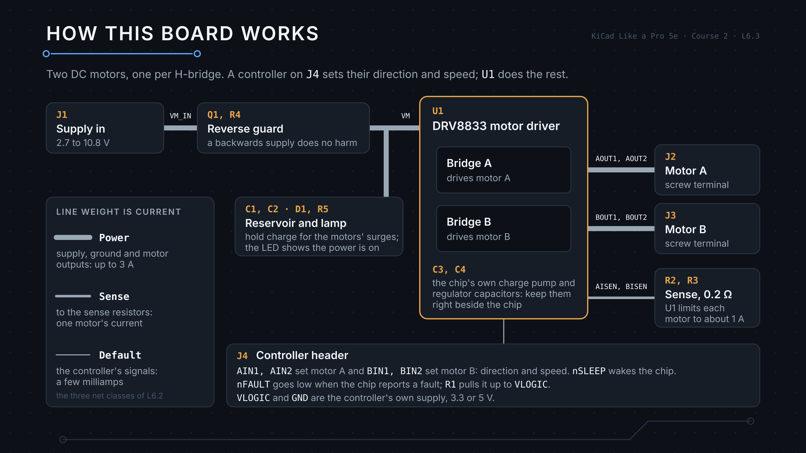

# How the DRV8833 board works

The picture above is the whole board on one sheet, as Lecture 6.3 shows it. The sections below are for when you want the reasoning behind a value.

A reference for the capstone board of Module 6. The lecture "Choose the values the datasheet leaves to you" carries only the numbers that change what goes on the sheet. This page carries the reasoning behind them, with the datasheet's own lines and their section numbers. "DRV8833" means Texas Instruments SLVSAR1E (the file `drv8833.pdf` in your parts project). "SUD45P03" means Vishay document 65595 for `Q1`.

## 1. The three currents

1. **The supply, `VM`:** up to 3 A, when both motors run hard together. It is two bridges at their rated current.
2. **Each bridge:** 1.5 A RMS, 2 A peak. The DRV8833 lists "1.5-A RMS, 2-A Peak per H-Bridge in PWP" (features list, DRV8833).
3. **The logic:** a few milliamps. The four direction inputs, `nSLEEP` and the open-drain `nFAULT` line move very little current.

These three tiers are the three net classes of lecture 6.2: `Power`, `Sense` and `Default`.

## 2. Reverse-polarity protection: Q1

A MOSFET has a diode built in between its drain and its body. In a P-channel device such as `Q1` that diode conducts from drain to source. `Q1` goes in with its drain on the incoming side.

1. **Supply correct.** The diode conducts and `VM` comes up through it. The gate sits at ground through `R4`, so the gate is `VM` below the source and the transistor turns fully on. The channel then carries the current instead of the diode.
2. **Supply reversed.** The diode blocks. The gate and the source sit together near ground, so the transistor never turns on. Nothing conducts and nothing is damaged.
3. **Why the channel matters.** The SUD45P03 gives RDS(on) of at most 0.0087 Ω at VGS = −10 V and at most 0.0150 Ω at VGS = −4.5 V (SUD45P03, first page). That is 8.7 mΩ and 15 mΩ: a few milliohms, so the drop across `Q1` is tiny next to the forward drop of the body diode.
4. **Why there is no Zener.** The gate sees at most `VM`. The DRV8833's operating range is "2.7 to 10.8 V" (DRV8833, recommended operating conditions), so the gate-source voltage never passes 10.8 V. The SUD45P03 is rated VGS ± 20 V (SUD45P03, absolute maximum ratings), in both directions. With the supply reversed the gate-source voltage goes positive by up to `VM`, which the same rating covers. A 24 V board would need a Zener across the gate and source, because 24 V is past the 20 V rating.
5. **Why source-in fails.** Wire `Q1` with its source on the incoming side, as the load switch in Module 5 was, and the board works perfectly. With the supply reversed, board ground becomes the highest potential, the diode conducts from `VM` back towards the input, and current flows backwards through every part on the board. ERC and DRC both pass: the drain and source are both passive pins on `Q1`'s symbol, so the ERC sees the same pin types on each net either way, and the DRC checks the board against that same sheet. Only a reversed supply shows it.

## 3. The bulk capacitor: C1

The datasheet's figures show a 10 µF capacitor on VM (its own `C4`; its `C1`, 0.01 µF, is the charge-pump capacitor on VCP, a different part from this board's `C1`). That 10 µF is the minimum ceramic bypass the VM pin wants (pin table, section 10.1), not a size for the motor's current. For the bulk capacitor the datasheet gives no value. Section 9.1 (Bulk Capacitance) says the amount "depends on a variety of factors", and lists them:

- the highest current required by the motor system;
- the capacitance and ability to source current;
- the parasitic inductance between the power supply and the motor system;
- the acceptable voltage ripple;
- the type of motor used;
- the motor braking method.

It adds: "The data sheet generally provides a recommended value, but system-level testing is required to determine the appropriate sized bulk capacitor." So 100 µF is a judgement for this board's current, to be confirmed by testing.

The rating is not a judgement. Section 9.1 says: "The voltage rating for bulk capacitors should be higher than the operating voltage, to provide margin for cases when the motor transfers energy to the supply." The operating voltage is at most 10.8 V, so `C1` is rated 25 V.

## 4. Current sensing: R2 and R3

1. **The value.** Section 8.2.2.2: "When the voltage on pin xISEN exceeds VTRIP (0.2 V), current regulation is activated." The resistor is sized as RISENSE = 0.2 V / ICHOP. "To set ICHOP to 1 A, RSENSE = 0.2 V / 1 A = 0.2 Ω." On the sheet the value reads `0R2`.
2. **How exact the limit is.** VTRIP is 160 mV minimum, 200 mV typical and 240 mV maximum (DRV8833, electrical characteristics). With 0.2 Ω that is a trip current of 0.8 A to 1.2 A, whatever the resistor's tolerance. A 1 % resistor spans 0.198 Ω to 0.202 Ω, which moves the limit far less than the chip's own spread does. A tighter resistor does not tighten the limit.
3. **The power.** Section 8.2.2.3: "The power dissipated by the sense resistor equals IRMS2 × R." At 1 A and 0.2 Ω each resistor turns 0.2 W into heat.
4. **The margin.** Section 8.2.2.3: "When a PCB is shared with other components generating heat, margin should be added." A 1206 thick-film resistor is commonly rated 0.25 W, which leaves almost no margin at 0.2 W, so the sheet specifies 0.5 W. Section 8.2.2.3 also says resistors have "a derated power curve for high ambient temperatures".

## 5. The control side

1. **No logic supply pin.** The chip has none, because its input thresholds are absolute. VIH is 2.5 V for `nSLEEP` and 2 V for all other pins (DRV8833, electrical characteristics), so a 3.3 V or a 5 V controller drives the inputs directly.
2. **`nFAULT` is open drain.** The pin table lists it as "OD" (open-drain output). It can pull its line low but never drive it high, so a resistor, `R1`, pulls it up.
3. **Which rail.** The controller reads whatever voltage `R1` goes to, so it must be a voltage the controller is built for. There are three candidates.
   - `VINT` is "Internal supply bypass" in the pin table (DRV8833, pin functions): a bypass point for the chip's own regulator, not a rail for outside loads, and not the controller's voltage.
   - `VM` is up to 10.8 V. A 3.3 V controller input cannot take that.
   - `VLOGIC`, on pin 1 of `J4`, is the controller's own rail. `R1` goes there and pin 1 connects to nothing else.
4. **Why `nSLEEP` may go to `VM` and `nFAULT` may not.** Section 7.3.4: "the nSLEEP can be pulled up to the supply (VM). TI recommends using a pullup resistor when this is done. This resistor limits the current to the input in case VM is higher than 6.5 V." The pin "has a clamping Zener diode that clamps the voltage at the pin at 6.5 V". That clamp is inside the chip on `nSLEEP` only. `nFAULT` has none, so the permission does not extend to it.

## 6. The pin table and the nets

`J4` brings eight signals in from the controller, in this order:

| Pin | Net |
|---|---|
| 1 | `VLOGIC` |
| 2 | `GND` |
| 3 | `nSLEEP` |
| 4 | `nFAULT` |
| 5 | `AIN1` |
| 6 | `AIN2` |
| 7 | `BIN1` |
| 8 | `BIN2` |

The sheet has nineteen named nets and one automatic net. The named nets are `VM_IN`, `VM`, `GND`, `AOUT1`, `AOUT2`, `BOUT1`, `BOUT2`, `AISEN`, `BISEN`, `VCP`, `VINT`, `VLOGIC`, `nFAULT`, `nSLEEP`, `AIN1`, `AIN2`, `BIN1`, `BIN2` and `GATE`. The automatic net, `Net-(D1-A)`, joins the LED and its series resistor `R5`.
